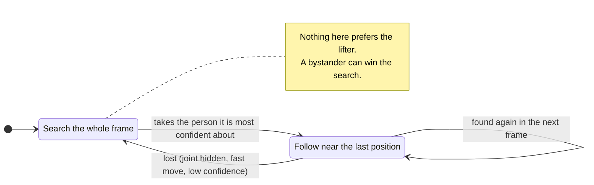
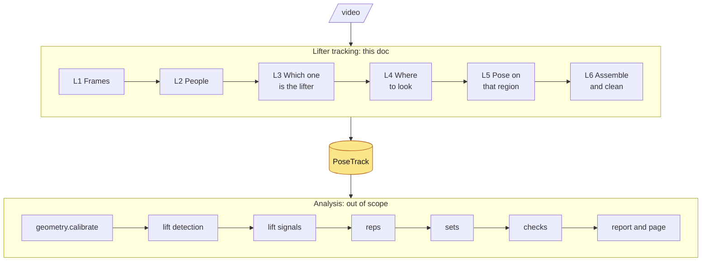
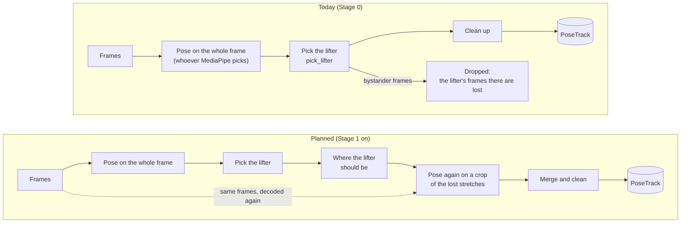
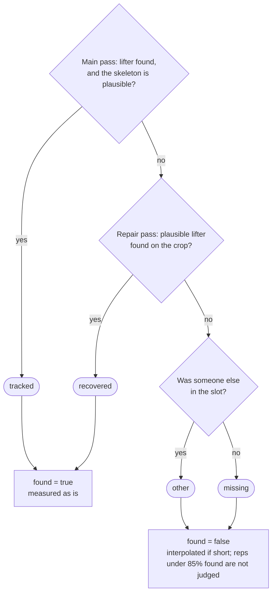
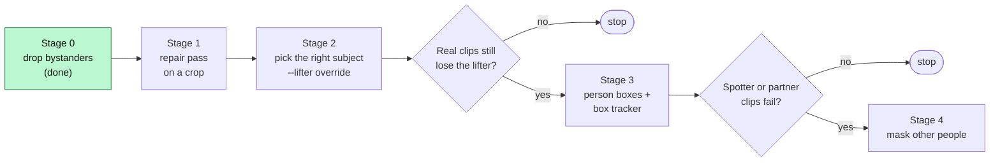
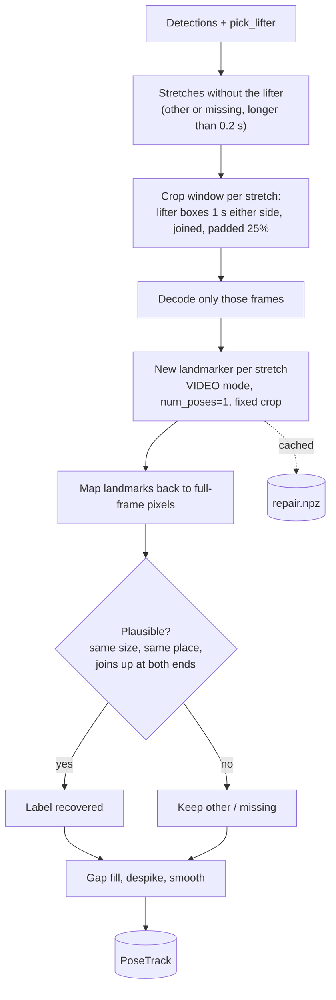
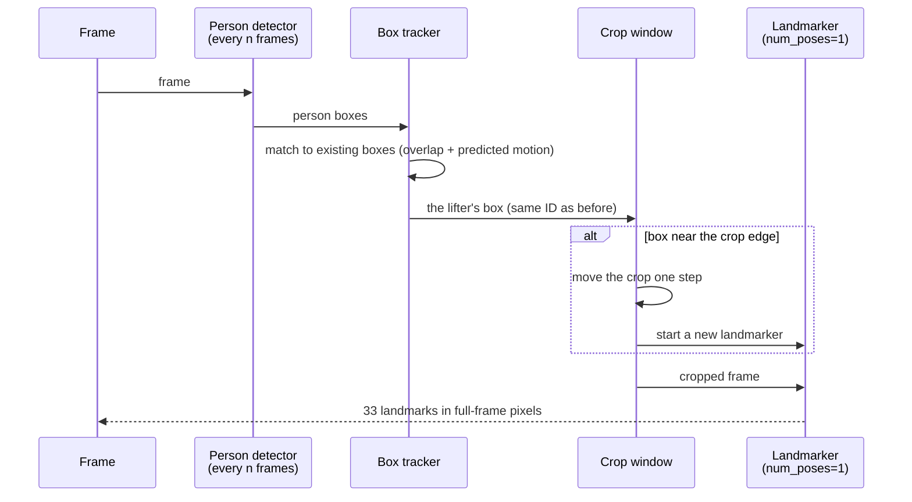

# Lifter Tracking: Design

How form-boss finds the lifter in a video and keeps following them when other people are in the
picture. This is the reference for anyone (person or agent) changing `pose.py` or anything that
decides whose skeleton gets analysed. Read **Rules** before changing code; update **Status** and
**Decisions** when you finish a stage.

Status (2026-11-19): Stage 0 is built (one tracked person, bystanders dropped afterwards). Stages 1-4
are planned. Nothing in Stages 1-4 is built yet.

---

## 1. The problem

Every check downstream assumes one skeleton per frame, and that it belongs to the lifter. In a
gym the video holds other people, mirrors and equipment, so "which person is this?" has to be
answered before anything is measured.

### Ways it goes wrong

| # | Failure | Lifter visible? | Recoverable? | Handled today |
|---|---|---|---|---|
| F1 | **Takeover**: the tracker loses the lifter for a moment and picks up a bystander, then keeps following them | Yes | Yes | Bystander frames dropped; the lifter's frames in that stretch are lost |
| F2 | **Wrong subject**: someone else fills more of the picture for longer than the lifter (a person close to the camera, a long rest between sets) | Yes | Yes | No: the biggest-for-longest tracklet wins |
| F3 | **Occlusion**: someone walks between the camera and the lifter | No | No: only interpolation across short gaps | Short gaps interpolated; reps <85% tracked are skipped |
| F4 | **Overlap**: a spotter or training partner stands behind or against the lifter | Partly | Partly | No: the model can mix limbs from both bodies |
| F5 | **Lifter moves**: walkout, deadlift setup, walking up to the camera, leaving and coming back | Yes | Yes | Partly: the tracker follows; `_plausible` rejects frames far from the lifter's usual spot |
| F6 | **Mirror**: the lifter's reflection is a second person doing the same reps | Yes | Yes | By luck: the reflection is usually smaller |
| F7 | **Turn-taking**: two people share a rack and do alternate sets | Yes | Product decision | No: whoever is bigger in total wins |

F1 is the one seen in real footage so far (`row_oblique_30fps`, 44.8-63.3 s). F4, F6 and F7 have
no test clips yet.

F3 cannot be fixed by software. The design goal there is to **say so**: list the reps in that
stretch as not judged and never make them up.

### Why the tracker takes over (F1)

MediaPipe Pose Landmarker in VIDEO mode with `num_poses=1` searches the whole frame for a person
once. After that it only looks near where the person was in the previous frame. When it loses
them (bar or plates hide a joint, fast movement, low confidence), it searches the whole frame
again and takes whichever person it is most confident about. It stays on that person until it
loses them too. So during a takeover **the lifter is usually still fully visible**; the model just
isn't looking at them.



What that looked like on `row_oblique_30fps` (68.5 s), from its cached tracking. Stretches under
0.3 s are left out. Stage 0 drops the red stretches. Stage 1 is meant to win back the lifter's
frames in the long red one.

```mermaid
gantt
    title row_oblique_30fps: who the tracker followed
    dateFormat x
    axisFormat %M:%S
    section Tracker followed
    no one          :done, 0, 4100
    bystander       :crit, 4100, 6600
    no one          :done, 6600, 10700
    lifter          :active, 10700, 44800
    bystander       :crit, 44800, 63300
    lifter          :active, 63300, 66300
    bystander       :crit, 66300, 67200
    no one          :done, 67200, 68500
    section Stage 1 target
    re-run pose on a crop around the lifter :44800, 63300
```



---

## 2. Where tracking sits in the pipeline



Everything right of `PoseTrack` is out of scope here. **`PoseTrack` is the boundary**: downstream
code reads `image`, `world`, `vis`, `found`, `fps`, `others`, and must not need to know how they
were produced. Tracking changes may add fields to `PoseTrack` (with defaults). They must not
change the meaning of existing ones.

---

## 3. Layers

Each layer has one job and a fixed input and output, so the parts can be swapped one at a time.
The "Today" column shows how the current code maps onto the layers. Today several layers share
one function. Splitting them is part of the work, not a requirement up front.

### The key change: the choice of lifter steers where the model looks

Today the lifter is picked **after** pose estimation, so the choice can only throw frames away.
In the planned design the choice feeds back into a second look at the video, so it can win
frames back.



| Layer | Job | Input → Output | Today | Planned |
|---|---|---|---|---|
| L1 Frames | Decode, skip frames on high-fps footage | video → RGB frames + timestamps | `detect` (stride, `TARGET_FPS`) | Unchanged; shared by every pass |
| L2 People | Find each person in a frame | frame → boxes (+ scores) | Implicit: whatever pose the landmarker returns | Stage 3: MediaPipe Object Detector, "person" class, every n frames |
| L3 Identity | Decide which person is the lifter and keep their identity across frames | people per frame → lifter timeline | `tracklets` + `pick_lifter` | Stage 1: same; Stage 2: better scoring, user hint; Stage 3: box tracker |
| L4 Region | Decide where to look for the lifter in each frame | lifter timeline → crop window (+ mask) per frame | None: whole frame | Stage 1: fixed crop per gap; Stage 3: every frame; Stage 4: masks |
| L5 Pose | Landmarks for the one person in the region | crop → 33 landmarks (image, world, vis) in **full-frame** pixels | `detect` on the whole frame | Same model, run on crops |
| L6 Assemble | Merge passes, reject implausible frames, fill short gaps, smooth, record where each frame came from | per-pass landmarks → `PoseTrack` | `build_track`, `_plausible`, `_fill_gaps`, `_despike`, `_smooth` | + per-frame `source`, gap-length limit |

### Data between layers

- **`Detections`** (exists): raw landmarker output for one pass, padded to `max_poses`. Cached in
  `out/<clip>/detections.npz`. Treat it as the raw record of what the model saw; don't edit it
  after the fact.
- **Lifter timeline** (new, Stage 1): one row per analysed frame:
  - `status`: one of
    - `tracked`: landmarks from the main pass
    - `recovered`: landmarks from a repair pass
    - `other`: someone else was tracked and the lifter wasn't found
    - `missing`: no one was found
  - `box`: the lifter's box in full-frame pixels, or none
  - `slot`: which detection slot holds the lifter

  This is what `pick_lifter` returns today in a reduced form (`slot`, `others`).
- **`PoseTrack`** (exists): adds `source: (T,) int8` holding the status above. `found` keeps its
  meaning (lifter landmarks are real, not interpolated). `others` keeps counting frames where
  someone else was set aside.

How each frame gets its label:



---

## 4. Plan

Each stage ships on its own, must pass the regression suite, and is recorded in `ROADMAP.md` with
measured results, the same way earlier phases were. Stages 3 and 4 are built only if real
footage shows the earlier stages are not enough.



### Stage 0: one tracked person, bystanders dropped afterwards (done)

`pose.pick_lifter`. The tracked skeleton is split where it jumps. The lifter is the tracklet with
the largest summed body size. Other tracklets fill the lifter's gaps only if they are in the same
place and about the same size. Setup advice is given when someone else was tracked for more than
2% of the clip.

### Stage 1: repair pass on lost stretches (F1, part of F5)

Re-run the pose model on the frames where the lifter was lost, looking only at where the lifter
should be.

1. After `pick_lifter`, find each stretch where the lifter isn't tracked (`other` or `missing`),
   ignoring stretches shorter than ~0.2 s, which interpolation already covers.
2. Build the lifter's box from the tracked frames on both sides of the stretch: the union of the
   boxes over ~1 s either side, padded by ~25% of body size. This needs full limb reach, so a
   row or press doesn't cut off the hands. If the stretch is at the start or end of the clip, use
   the one side there is.
3. Decode only those frames (L1). Create a **new** landmarker for each stretch (VIDEO mode,
   `num_poses=1`). Run it on the crop, with the **crop window fixed for the whole stretch**.
4. Map the landmarks back to full-frame pixels. World landmarks are relative to the hips and need
   no mapping. Visibility is unchanged.
5. Accept a repaired frame only if `_plausible` passes against the main-pass lifter: same size
   (0.7-1.4×) and same place. The pass must also join up smoothly with the tracked frames at both
   ends, so the hip centre doesn't jump at the boundary.
6. Mark accepted frames `recovered`. Merge them into the track before gap filling and smoothing.
7. Cache the repair output next to `detections.npz` (`repair.npz`), keyed on the detections cache
   key + repair version + stretch list.



The crop window, in the picture:

```
 full frame
┌───────────────────────────────────────────────────────────────────────────────┐
│                                                                               │
│   ┌──────────── crop window, fixed for the stretch ────────────┐              │
│   │                                                            │              │
│   │   ┌─ lifter, 1 s before ─┐   ┌─ lifter, 1 s after ─┐       │              │
│   │   │          O           │   │          O          │       │      O       │
│   │   │         /|\          │   │         /|\         │       │     /|\      │
│   │   │         / \          │   │         / \         │       │     / \      │
│   │   └──────────────────────┘   └─────────────────────┘       │  bystander   │
│   │                                                            │              │
│   │<- 25% of body size                      25% of body size ->│              │
│   └────────────────────────────────────────────────────────────┘              │
│                                                                               │
└───────────────────────────────────────────────────────────────────────────────┘
 The bystander is in the video but outside the crop, so the model never sees them.
```

Why a fixed crop: MediaPipe follows a person from frame to frame in the coordinates of the image
it is given. Moving the crop under it every frame moves the person in those coordinates and
breaks that following. A lifter who stays in place doesn't need a moving crop. A lifter who
walks does, and that is Stage 3.

What it does not fix: a bystander who walks through the crop can still be picked up. Step 5
rejects most of these, and Stage 4 handles the rest.

**Done when**
- `row_oblique_30fps`: most of 44.8-63.3 s comes back as `recovered`. Check by eye on the result
  page that it is the lifter. Rep count and findings change only in that stretch.
- Every other regression clip is unchanged: no stretches to repair, or identical output. Any
  baseline diff is explained in the commit.
- Synthetic test in `tests/test_pose.py`: a takeover stretch with the lifter present in the
  "repair" detections is merged; a repair that returns the bystander is rejected.
- Runtime grows only by the length of the repaired stretches.

### Stage 2: pick the right subject (F2, F6, F7)

Improve how the lifter tracklet is chosen, and let the user overrule it.

- **Scoring signals** in addition to summed body size:
  - stays in one place (low drift of the hip centre)
  - does the movement being analysed: the lift's rep signal dips repeatedly on this tracklet
  - near the centre of the picture
  - not a mirror image: a reflection's left and right are swapped relative to its facing
    direction, and it moves in sync with another tracklet
- **Ambiguity is reported, not hidden**: if the two best candidates score within a set margin,
  log it, add a setup finding ("two people could be the lifter; pass `--lifter`"), and go with
  the best.
- **User hint**: `--lifter X,Y`, a point in the first frame, in pixels or fractions of the frame.
  The tracklet whose box contains the point (or is nearest to it) becomes the lifter, overriding
  the scores. Later, this can be a click on the first frame of the result page that re-runs the
  analysis.
- **Turn-taking (F7)** is a product decision. For now: one lifter per analysis. With `--lifter`
  the user picks; without it the highest score wins and the ambiguity finding fires. Analysing
  every person in turn is out of scope until someone asks for it.

Scoring by "does the lift" fails against a mirror, since the reflection does the lift too. That
is why the mirror check must be a separate rule and not one more weight in the score.

**Done when**: synthetic tests cover each signal. A real clip with a mirror, or with a large
bystander near the camera, picks the lifter (needs footage, see §6). Existing clips are
unchanged.

### Stage 3: person boxes and a box tracker (F1, F5 in full)

Only if Stages 1-2 leave failures in real clips. It replaces "find the lifter after the fact"
with "only ever look at the lifter".

- L2: MediaPipe Object Detector (EfficientDet-Lite, `person` class) every n frames. It is part of
  the `mediapipe` package already installed; only its model file is new.
- L3: a box tracker, matching boxes across frames by overlap with a motion prediction
  (ByteTrack-style, about 100 lines, no new dependencies). The lifter's box ID is chosen once
  (Stage 2 rules or `--lifter`) and kept from then on.
- L4: crop window from the lifter's box in every frame. To keep the pose model's frame-to-frame
  following working (see Stage 1), move the crop only when the box nears its edge, in steps, and
  start a new landmarker after each step.
- L5/L6 as Stage 1, now over the whole clip. The Stage 0 single-pass path stays as the fallback
  when no person boxes are found.

Cost: detection runs twice over the whole clip (people and pose), roughly doubling the slow
part. The cache makes repeat runs cheap.



### Stage 4: masking overlapping people (F4)

Only with spotter or partner footage that fails. Get an outline mask for each person, from the
landmarker (`output_segmentation_masks=True`, which only gives one per person it found) or the
Image Segmenter. Then grey out every pixel inside the crop that belongs to someone other than the
lifter before the pose model sees it. The open question is whether the model handles the grey
patches well; measure before relying on it.

### Considered and rejected

- **`num_poses > 1` for landmarks.** MediaPipe then searches for people from scratch every frame
  instead of following the lifter, and the landmarks were about 8× noisier: the knee flipped at
  the bottom of every squat and split reps. Fine for L2 (finding boxes), never for L5.
- **Ultralytics YOLO-pose / tracking.** Easy, with tracking built in, but the AGPL licence and
  PyTorch dependency are both heavy. Only 17 keypoints and no 3D estimate, which `geometry.py`
  needs.
- **RTMPose / rtmlib.** Good multi-person accuracy, Apache-licensed. But it uses the same 17-point
  layout with no 3D estimate, so MediaPipe would still be needed for landmarks. Revisit only if
  MediaPipe's own person detector (Stage 3) isn't good enough.

---

## 5. Rules

These hold at every stage. Breaking one needs a line in **Decisions** saying why.

1. **One landmarker, one person, `num_poses=1`.** Landmarks always come from a single-person
   landmarker. Multi-person detection is only for finding boxes.
2. **`PoseTrack` is the boundary.** Code after `pose.track` reads `PoseTrack` only, never
   `Detections` or repair output. New information is added as `PoseTrack` fields with defaults.
3. **One body per frame.** A frame's landmarks all come from one person and one pass. Never mix
   joints from two passes or two people in a frame.
4. **Full-frame pixels.** `PoseTrack.image` is always in the original video's pixel coordinates,
   whatever crop produced it. Crops are mapped back in L5 and nowhere else.
5. **Don't invent reps.** Gaps are interpolated so the signals are continuous. But a rep that is
   mostly interpolated (`found` < 85% of the rep, as `cli.analyze` checks today) is not judged,
   and the report says why. Repaired frames count as found; interpolated ones don't.
6. **Every landmark frame is labelled with where it came from.** (`source`, from Stage 1.) The
   result page should be able to show the frames that were recovered, set aside, or
   interpolated.
7. **A new landmarker per pass and per crop window.** VIDEO-mode timestamps must keep increasing
   within an instance, and the following-from-the-last-frame state must not carry over between
   windows.
8. **Caching.** Bump `CACHE_VERSION` when the meaning of `detect` output changes. Repair and box
   output are cached in their own files, keyed on the detections key plus their own version, so
   tuning one layer doesn't re-run the slow pose pass.
9. **No heavy dependencies** (PyTorch, AGPL code, GPU-only paths) without a recorded decision.
   Anything under `mediapipe`, `opencv-python`, `numpy` and `scipy` is fine.
10. **Measure on real clips.** Every stage reports what it changed on `scripts/regress.py` and
    the Mendeley set, as Phases 1-6 in `ROADMAP.md` do. A regression baseline is updated
    (`--update`) only alongside a commit message explaining each diff.

---

## 6. Testing and evidence

- **Synthetic** (`tests/test_pose.py`): skeletons built in code for each failure in §1: takeover,
  bigger bystander, walk-through, mirror (horizontally flipped copy, in sync), two people
  alternating. Fast, no video needed, and they pin down the L3/L6 logic.
- **Regression** (`tests/regression.toml`, `scripts/regress.py`): rep counts and findings per clip.
  Tracking changes should leave every clip without a tracking problem byte-identical.
- **Ground truth for tracking** (to add): `tests/tracking_labels.toml`, with time ranges per clip
  marked `lifter`, `other`, `occluded`. Label by watching the clip. Measure: the share of frames
  with the lifter visible that end up `tracked` or `recovered` (recall), and the share of
  `tracked`/`recovered` frames that really are the lifter (precision). Start with
  `row_oblique_30fps`.
- **Footage needed** (add to the Phase 4 table in `ROADMAP.md`):
  - someone walking between the camera and the lifter mid-set (F3)
  - a spotter behind a squat (F4)
  - a mirror behind the lifter (F6)
  - two people alternating sets on one rack (F7)
  - a busy background with people close to the camera (F2)

---

## 7. Decisions

| Date | Decision | Why |
|---|---|---|
| 2026-11-19 | `num_poses=1`; bystanders removed after tracking (Stage 0) | Multi-person mode made landmarks ~8× noisier |
| 2026-11-19 | Fix F1 with a repair pass on a fixed crop first (Stage 1), before a full detector-and-tracker pipeline | Cheapest change that recovers the frames seen lost in real footage; no new dependencies; extra cost only in the lost stretches |
| 2026-11-19 | One lifter per analysis; turn-taking resolved by `--lifter` | Keeps reports single-person; multi-person reports wait for demand |

## 8. Open questions

- Gap length: how long can a gap be and still be interpolated for signals, vs. ending the rep
  there? Today every gap is filled, and only the 85% rule protects the checks.
- Should repaired frames get a lower weight in checks (e.g. excluded from bottom-of-rep angles)
  until Stage 1 has been checked on more footage?
- Is EfficientDet-Lite good enough at finding people who are lying on a bench or folded over a
  deadlift bar? Test before relying on it in Stage 3.
- How should the result page show tracking: a strip under the timeline coloured by `source`?
